# Prompt blocks

Reusable prompt blocks for coding models and agents. Run them on your own model and compare the results.

## What is a block

A block is a section of prompt text you paste into your own prompt. Each one fixes a known class of defect that models repeatedly produce on that kind of task (for example fog that is a screen-space tint instead of density, or characters whose feet slide). The blocks contain fixed numbers, each of which came from a defect seen in real runs.

## How to use one

- Append the block to your own prompt, after the description of your scene.
- Or run the full `PROMPT.md` of a block folder as it is, as one message to a coding model or agent. The full prompts end with a short block that asks for a file that runs correctly the first time.

## Blocks

### Fog: [fog/](fog/)

Volumetric ground fog that drifts, catches light and is stirred by moving objects. Files: [FOG-BLOCK.md](fog/FOG-BLOCK.md) (the block), [PROMPT.md](fog/PROMPT.md) (the full test prompt). Existing demo: [loktar00/fog-demo](https://github.com/loktar00/fog-demo), live at https://loktar00.github.io/fog-demo/.

| Model | Harness | Result page | Video |
| --- | --- | --- | --- |
| DeepSeek V4.1 Flash | DeepSeek Harness | [fog-demo](https://loktar00.github.io/fog-demo/) | [Video](https://loktar00.github.io/prompt-blocks/fog/results/deepseek/deepseek.mp4) |
| Fable 5.2 | Claude Code | coming soon | coming soon |
| Maya | coming soon | coming soon | coming soon |
| Strata | coming soon | coming soon | coming soon |

### Walk: [walk/](walk/)

Procedural humanoid characters with a walk, run and fight-stance animation. Files: [CHARACTER-MODEL-BLOCK.md](walk/CHARACTER-MODEL-BLOCK.md), [WALK-BLOCK.md](walk/WALK-BLOCK.md), [PROMPT.md](walk/PROMPT.md) (the full test prompt, which contains both blocks).

| Model | Harness | Result page | Video |
| --- | --- | --- | --- |
| Fable 5.2 | Claude Code | [Run it live](https://loktar00.github.io/prompt-blocks/walk/results/fable52/index.html) | [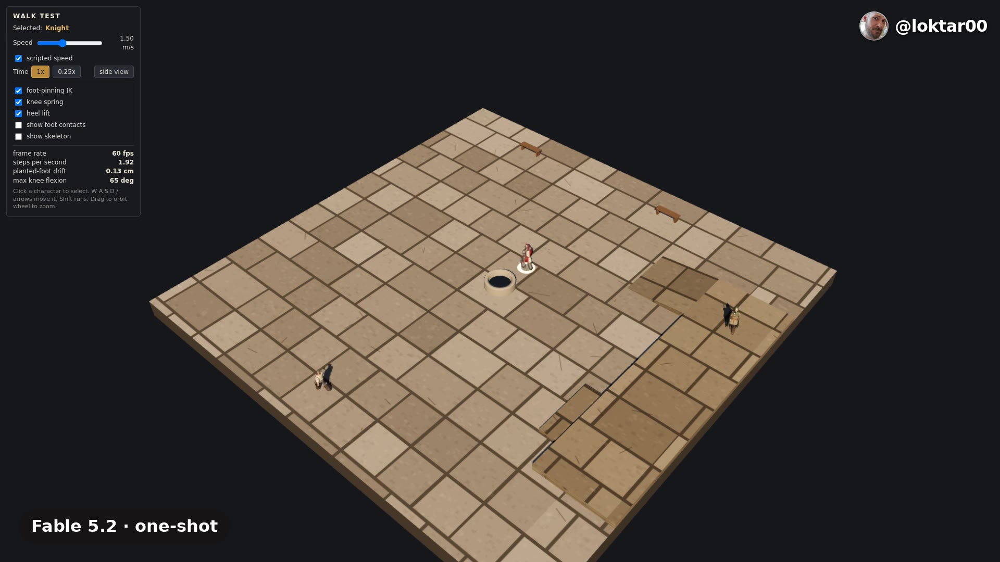](https://loktar00.github.io/prompt-blocks/walk/results/fable52/fable52.mp4) |
| Opus 5.5 | One-shot | [Run it live](https://loktar00.github.io/prompt-blocks/walk/results/opus55/index.html) | [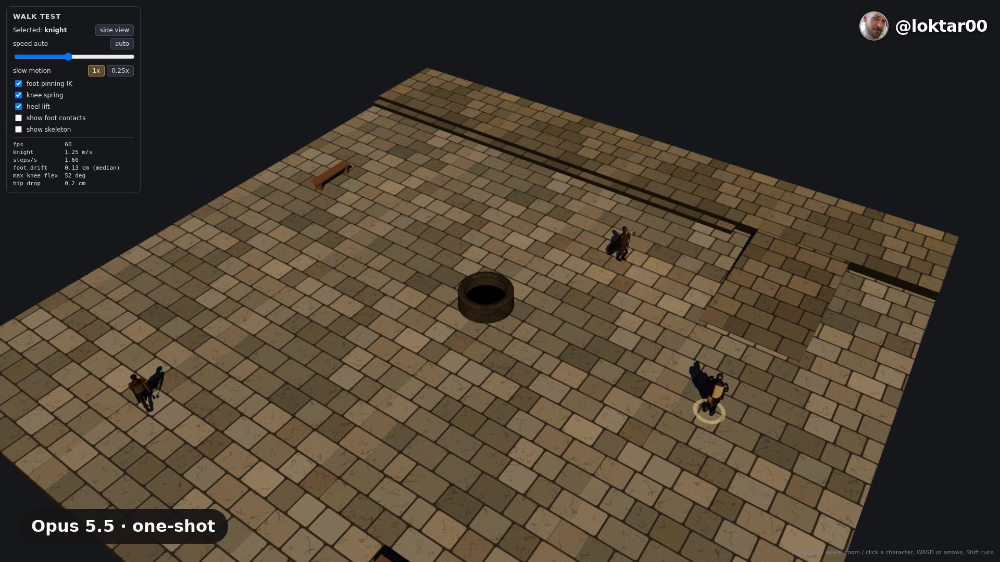](https://loktar00.github.io/prompt-blocks/walk/results/opus55/opus55.mp4) |
| DeepSeek | DeepSeek Harness | [Run it live](https://loktar00.github.io/prompt-blocks/walk/results/deepseek/index.html) | [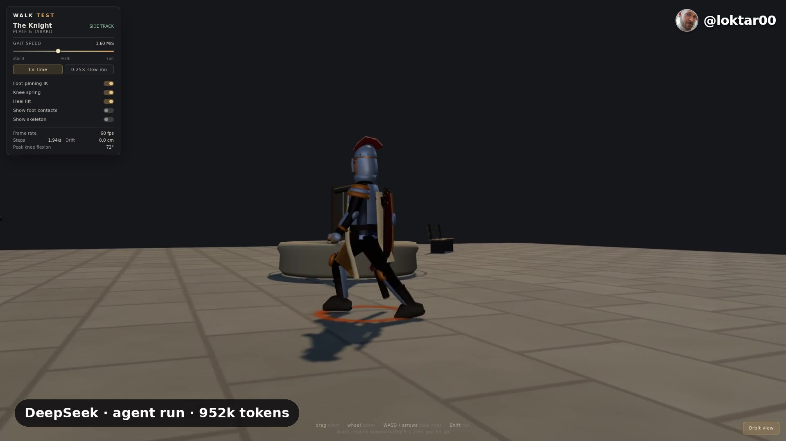](https://loktar00.github.io/prompt-blocks/walk/results/deepseek/deepseek.mp4) |
| Flash-Next FP8 | DeepSeek Harness | [Run it live](https://loktar00.github.io/prompt-blocks/walk/results/flashnext-fp8/index.html) | [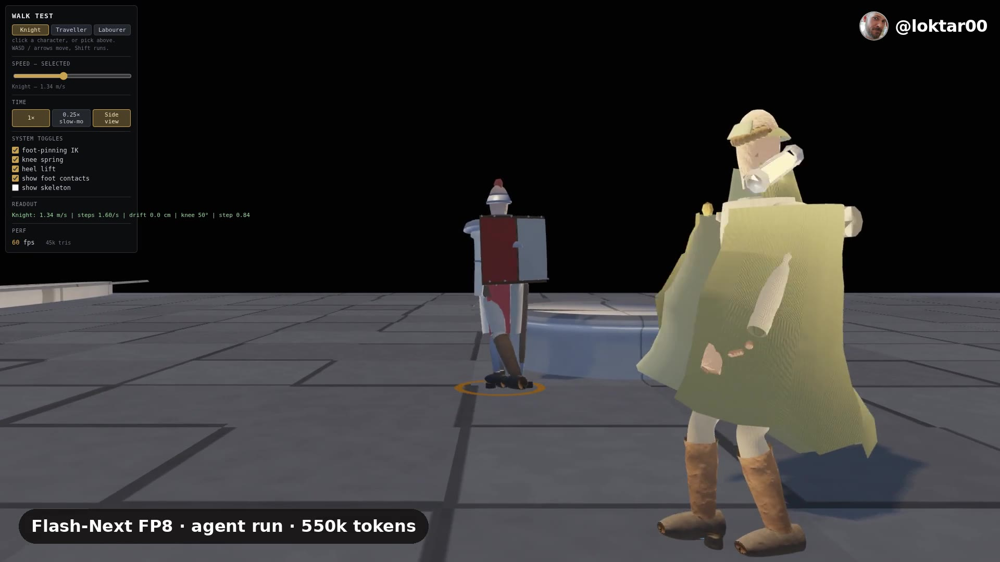](https://loktar00.github.io/prompt-blocks/walk/results/flashnext-fp8/flashnext-fp8.mp4) |
| Maya | DeepSeek Harness | [Run it live](https://loktar00.github.io/prompt-blocks/walk/results/maya/index.html) | [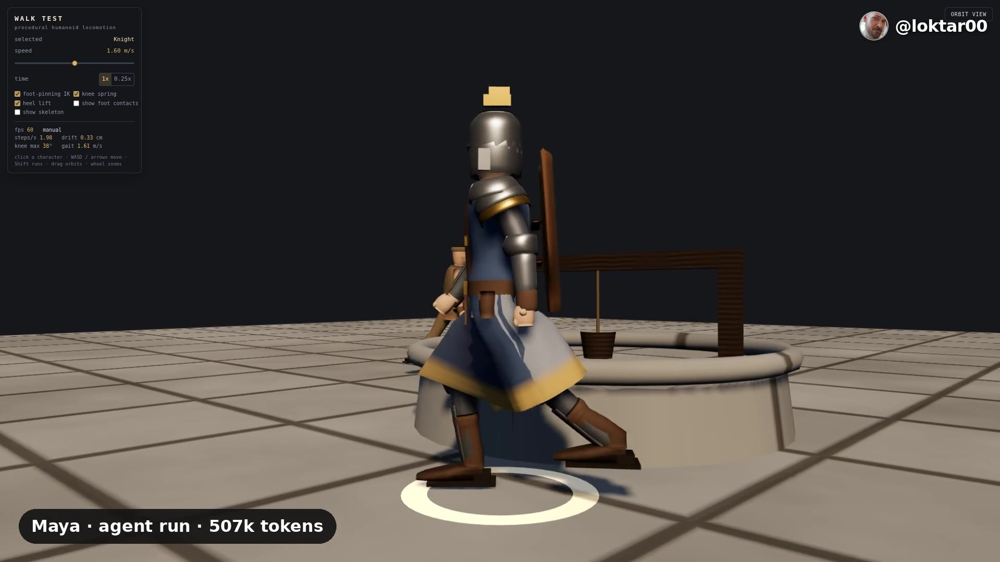](https://loktar00.github.io/prompt-blocks/walk/results/maya/maya.mp4) |
| Strata | DeepSeek Harness | [Run it live](https://loktar00.github.io/prompt-blocks/walk/results/strata/index.html) | [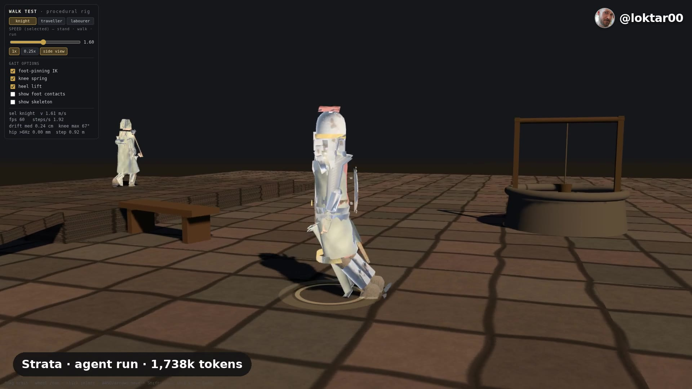](https://loktar00.github.io/prompt-blocks/walk/results/strata/strata.mp4) |

<!-- results:start -->
## Fog results

Agent run of [fog/PROMPT.md](fog/PROMPT.md).

### DeepSeek V4.1 Flash · agent run

[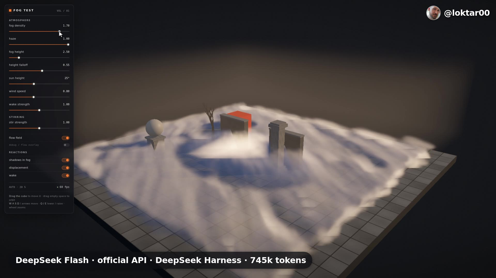](https://loktar00.github.io/prompt-blocks/fog/results/deepseek/deepseek.mp4)

[Video](https://loktar00.github.io/prompt-blocks/fog/results/deepseek/deepseek.mp4) · [Run it live](https://loktar00.github.io/prompt-blocks/fog/results/deepseek/index.html)

## Walk results

One-shot runs of [walk/PROMPT.md](walk/PROMPT.md). Gallery page: [index.html](index.html).

[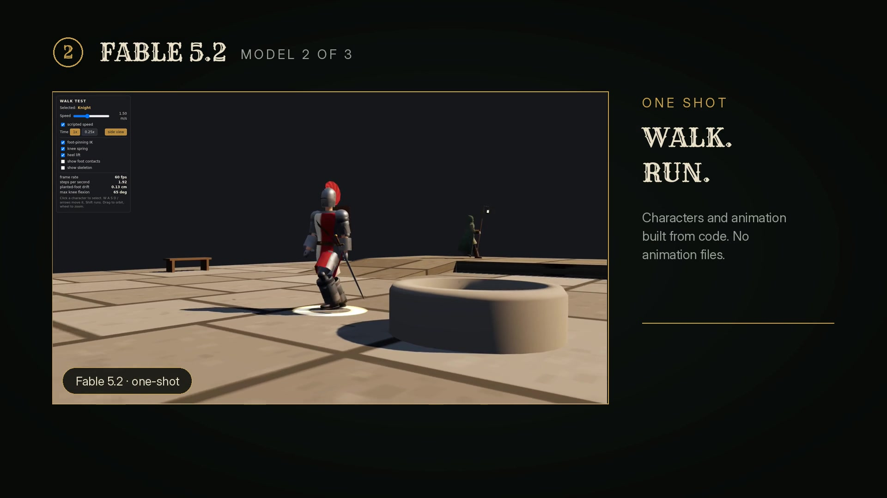](https://loktar00.github.io/prompt-blocks/walk/showcase.mp4)

Screenshots:

[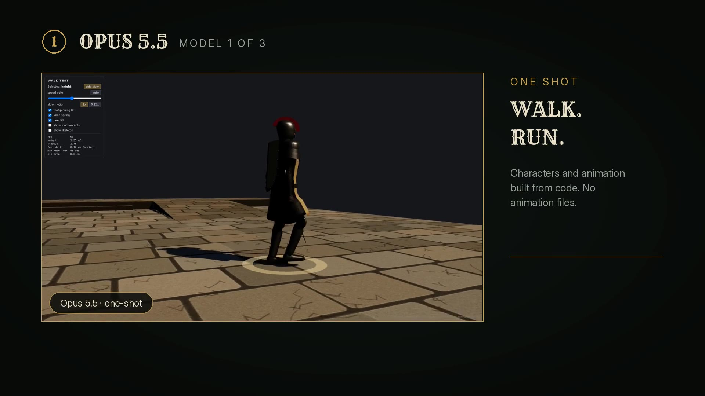](https://loktar00.github.io/prompt-blocks/walk/showcase.mp4) [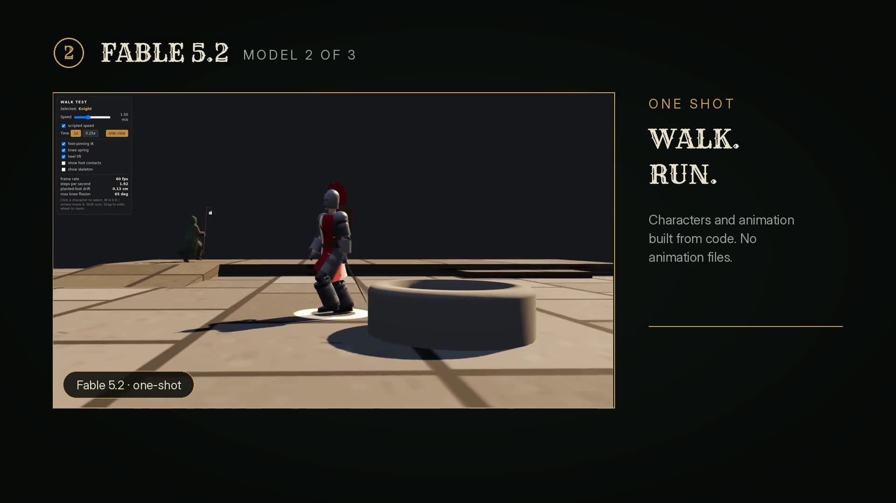](https://loktar00.github.io/prompt-blocks/walk/showcase.mp4) [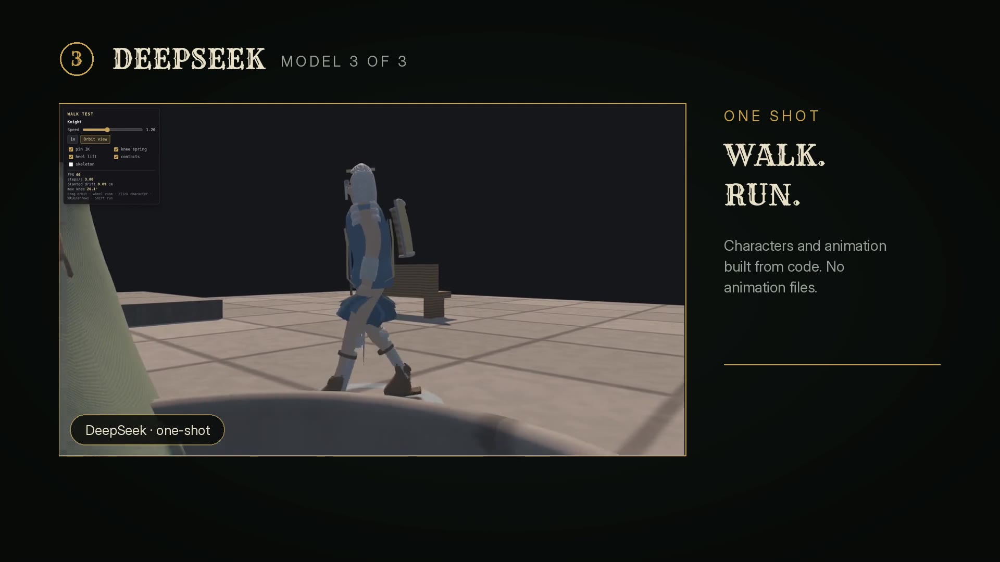](https://loktar00.github.io/prompt-blocks/walk/showcase.mp4)

[Showcase video](https://loktar00.github.io/prompt-blocks/walk/showcase.mp4)

### Fable 5.2 · one-shot

[Video](https://loktar00.github.io/prompt-blocks/walk/results/fable52/fable52.mp4) · [Run it live](https://loktar00.github.io/prompt-blocks/walk/results/fable52/index.html)

### Opus 5.5 · one-shot

[Video](https://loktar00.github.io/prompt-blocks/walk/results/opus55/opus55.mp4) · [Run it live](https://loktar00.github.io/prompt-blocks/walk/results/opus55/index.html)

### DeepSeek · agent run

[Video](https://loktar00.github.io/prompt-blocks/walk/results/deepseek/deepseek.mp4) · [Run it live](https://loktar00.github.io/prompt-blocks/walk/results/deepseek/index.html)

### Flash-Next FP8 · agent run

[Video](https://loktar00.github.io/prompt-blocks/walk/results/flashnext-fp8/flashnext-fp8.mp4) · [Run it live](https://loktar00.github.io/prompt-blocks/walk/results/flashnext-fp8/index.html)

### Maya · agent run

[Video](https://loktar00.github.io/prompt-blocks/walk/results/maya/maya.mp4) · [Run it live](https://loktar00.github.io/prompt-blocks/walk/results/maya/index.html)

### Strata · agent run

[Video](https://loktar00.github.io/prompt-blocks/walk/results/strata/strata.mp4) · [Run it live](https://loktar00.github.io/prompt-blocks/walk/results/strata/index.html)

<!-- results:end -->

## Credits

- 3D engine used by the prompts: [three.js](https://threejs.org/) (MIT).
